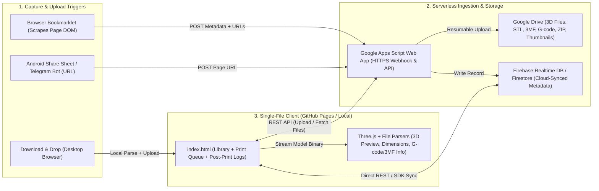
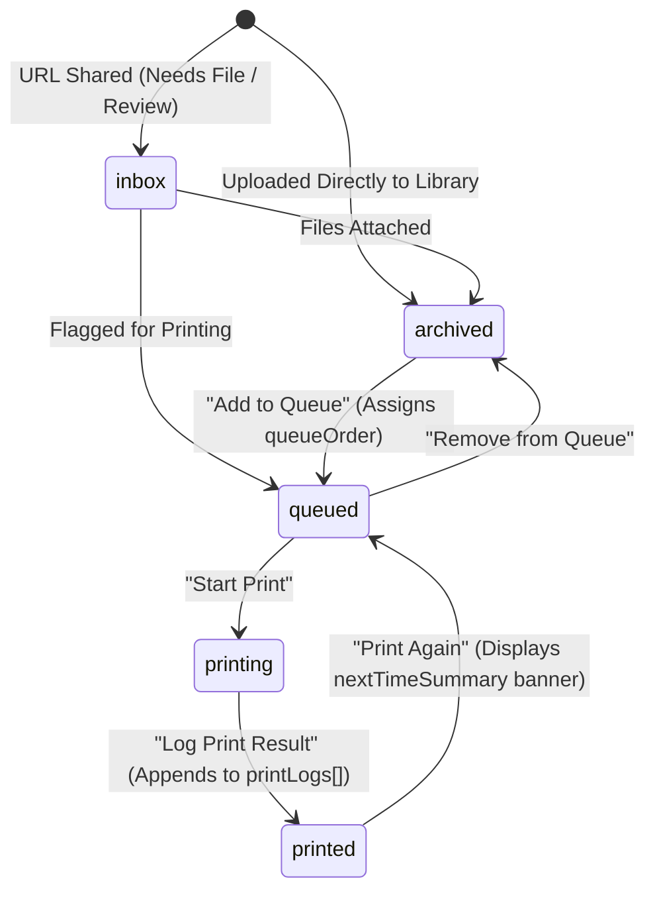

# System Architecture & Metadata Specification

This document defines the end-to-end architecture, ingestion workflows, and Firebase JSON metadata schema for **3D Model Vault**.

---

## 1. End-to-End Architecture



---

## 2. Core Ingestion Workflows

Because 3D repositories (Thingiverse, MakerWorld, Printables, Cults3D) vary in how they serve files and whether they block automated bots, the system supports three complementary ingestion paths that all produce the same normalized Firebase record:

### Path A: "Download & Drop" (Desktop — Primary & Universal)
1. You download the `.stl`, `.3mf`, `.gcode`, or `.zip` from a 3D repository (or export it from your CAD/slicer software).
2. You drag-and-drop the file(s) into the single-file web UI (`index.html`) and optionally paste the source URL.
3. **Client-side auto-extraction (Zero server cost):**
   - **`.stl`**: Three.js renders the model, calculates exact bounding-box dimensions (`X × Y × Z mm`), and captures a PNG thumbnail snapshot.
   - **`.3mf`**: JSZip inspects the archive in memory to extract embedded build-plate thumbnails and XML slicer metadata.
   - **`.gcode`**: Header/footer comment parser extracts estimated print time, filament weight (`g`), layer height, and nozzle size.
4. The UI sends the file binary + thumbnail to Google Drive (via the Apps Script API) and writes the metadata record to Firebase.

### Path B: Browser Bookmarklet (1-Click Page Capture)
1. While viewing a model page on Thingiverse, MakerWorld, or Printables, you click the **Save to 3D Vault** bookmarklet.
2. Because it runs inside your active browser tab, it bypasses Cloudflare/anti-bot blocks and directly reads the page title, author, license, description, preview image, and download links.
3. It sends that metadata to your Apps Script webhook (or opens your Vault UI with the fields pre-filled so you can drop the downloaded file right in).

### Path C: Mobile Share / URL Webhook (Hands-Free Queuing)
1. From your phone (Android Share Sheet or Telegram Bot), you share a model URL to your Google Apps Script HTTPS endpoint.
2. Apps Script scrapes OpenGraph / page metadata, downloads the archive if publicly accessible, saves it to a dedicated folder in Google Drive, and creates the Firebase record.
3. If the site requires an interactive login to download the file, Apps Script saves the metadata + preview image with `"ingestionState": "needs_files"` so it waits in your inbox until you drop the file from your desktop.

---

## 3. Google Drive Folder Structure

To keep Google Drive clean and human-browsable even outside the web app:

```text
/3D Model Vault (Root Folder)
 ├── /Models
 │    ├── /2026-11-19_gridfinity-tool-holder_m_8f92a1
 │    │    ├── thumbnail.png
 │    │    ├── holder_v2.3mf
 │    │    ├── holder_v2.stl
 │    │    └── holder_v2_0.2mm_PETG.gcode
 │    └── /2026-11-19_custom-enclosure-bracket_m_3c41b9
 │         ├── thumbnail.png
 │         ├── bracket.f3d          (role: cad_source)
 │         └── bracket.stl          (role: printable)
 └── /_Inbox                        (Optional watch folder for raw file drops)
```

---

## 4. Unified Firebase Metadata Schema

All models are stored under `/models/{modelId}`. The schema is split into **6 logical sections** so personal designs and scraped third-party models share the exact same structure:

1. **Core Identity & Classification** (`id`, `title`, `sourceType`, `tags`, `category`)
2. **Source Provenance** (`source` — populated for Thingiverse/MakerWorld/etc., or CAD info for personal designs)
3. **Storage & Files** (`driveFolderId`, `thumbnailDriveId`, `files[]`)
4. **Extracted Technical Specs** (`specs` — dimensions, print time, filament usage pulled from STL/3MF/G-code)
5. **Print Queue / Waitlist Workflow** (`workflow` — status, queue priority order, target filament/printer)
6. **Post-Print Notes & History** (`nextTimeSummary`, `printLogs[]` — timestamped print outcomes and *"for next time"* reminders)

### Complete JSON Record Example

```json
{
  "id": "m_8f92a1",
  "title": "Gridfinity 2x3 Pliers & Flush Cutter Holder",
  "description": "Low-profile Gridfinity holder with magnet holes.",
  "sourceType": "makerworld",
  "ingestionState": "complete",
  "category": "Workshop & Tools",
  "tags": ["gridfinity", "organizer", "pliers", "workshop"],
  "createdAt": "2026-11-19T22:15:00Z",
  "updatedAt": "2026-11-19T22:45:00Z",

  "source": {
    "isPersonalDesign": false,
    "siteName": "MakerWorld",
    "url": "https://makerworld.com/en/models/123456",
    "externalId": "makerworld:123456",
    "author": "MakerJane",
    "authorUrl": "https://makerworld.com/en/@MakerJane",
    "license": "CC BY-NC-SA 4.0",
    "cadTool": null,
    "designVersion": null
  },

  "storage": {
    "driveFolderId": "1AbCdEfGhIjKlMnOpQrStUvWxYz",
    "driveFolderUrl": "https://drive.google.com/drive/folders/1AbCdEfGhIjKlMnOpQrStUvWxYz",
    "thumbnailDriveId": "1ThUmBnAiLiD987654321",
    "thumbnailFallbackUrl": "https://makerworld.bblmw.com/..."
  },

  "files": [
    {
      "fileId": "f_01",
      "driveFileId": "1FiLeIdStL12345",
      "fileName": "gridfinity_pliers_2x3.stl",
      "extension": "stl",
      "role": "printable",
      "sizeBytes": 4821900,
      "uploadedAt": "2026-11-19T22:15:10Z"
    },
    {
      "fileId": "f_02",
      "driveFileId": "1FiLeId3Mf67890",
      "fileName": "gridfinity_pliers_2x3_bambu.3mf",
      "extension": "3mf",
      "role": "print_profile",
      "sizeBytes": 2150400,
      "uploadedAt": "2026-11-19T22:15:14Z"
    }
  ],

  "specs": {
    "dimensionsMm": {
      "x": 84.0,
      "y": 126.0,
      "z": 42.5
    },
    "estimatedPrintTimeSeconds": 8040,
    "estimatedPrintTimeDisplay": "2h 14m",
    "filamentWeightGrams": 68.4,
    "filamentLengthMeters": 22.9,
    "recommendedMaterial": "PETG",
    "layerHeightMm": 0.2,
    "nozzleDiameterMm": 0.4,
    "infillPercent": 15,
    "supportsRequired": false
  },

  "workflow": {
    "status": "queued",
    "queueOrder": 1,
    "priority": "high",
    "queuedAt": "2026-11-19T22:30:00Z",
    "targetPrinter": "Bambu P1S",
    "targetFilament": "Polymaker PETG Dark Grey",
    "quantityToPrint": 1,
    "favorite": true
  },

  "nextTimeSummary": "Scale magnet holes by 101% or use a drop of CA glue; 15% gyroid infill is plenty strong.",

  "printLogs": [
    {
      "logId": "log_01",
      "printedAt": "2026-11-19T22:45:00Z",
      "outcome": "needs_tweaks",
      "printerUsed": "Bambu P1S",
      "filamentUsed": "eSUN PLA+ Black",
      "actualPrintTimeDisplay": "2h 10m",
      "rating": 4,
      "notes": "Printed cleanly with no stringing, but 6x2mm press-fit magnet holes were slightly too tight.",
      "forNextTime": "Add +0.1mm XY hole compensation in slicer before printing the second bin."
    }
  ]
}
```

---

## 5. Field Differences by Origin (`sourceType`)

| Metadata Section | Personal Upload (`sourceType: "personal"`) | Repository Model (`thingiverse`, `makerworld`, `printables`, etc.) |
| :--- | :--- | :--- |
| **`source`** | `isPersonalDesign: true`, `cadTool` (`"Fusion 360"`, `"FreeCAD"`, `"Blender"`), `designVersion` (`"v1.2"`), `license: "Personal"` | `url`, `externalId` (for deduplication), `author`, `license` (`"CC BY-NC"`), `siteName` |
| **`files[].role`** | Often includes `"cad_source"` (`.f3d`, `.step`, `.scad`) alongside `"printable"` (`.stl`, `.3mf`) | Typically `"printable"` (`.stl`), `"print_profile"` (`.3mf`), `"sliced"` (`.gcode`), or `"archive"` (`.zip`) |
| **`specs`** | Auto-extracted from `.stl` (3D bounding box via Three.js), `.3mf`, or `.gcode` on upload | Combined from scraped page profile + client-side `.stl` / `.3mf` / `.gcode` inspection |
| **`workflow`** | Identical — can be queued, prioritized, or archived | Identical — can be queued, prioritized, or archived |
| **`printLogs[]` & `nextTimeSummary`** | Identical — tracks design iteration tweaks & fitment tolerances | Identical — tracks slicer profile tweaks, scaling, & filament notes |

---

## 6. Print Queue & Waitlist State Machine



- **`nextTimeSummary` Banner:** Whenever a model has previous entries in `printLogs[]` or a pinned `nextTimeSummary`, the UI highlights that note at the top of the Queue card so you never forget a slicer tweak before starting a repeat print.
